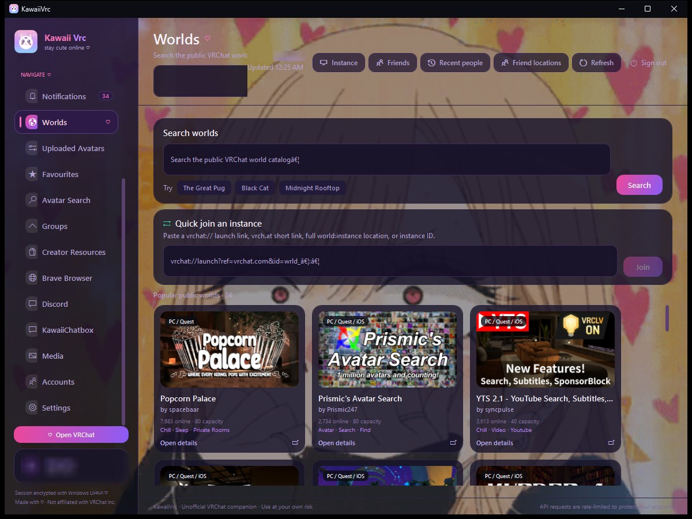
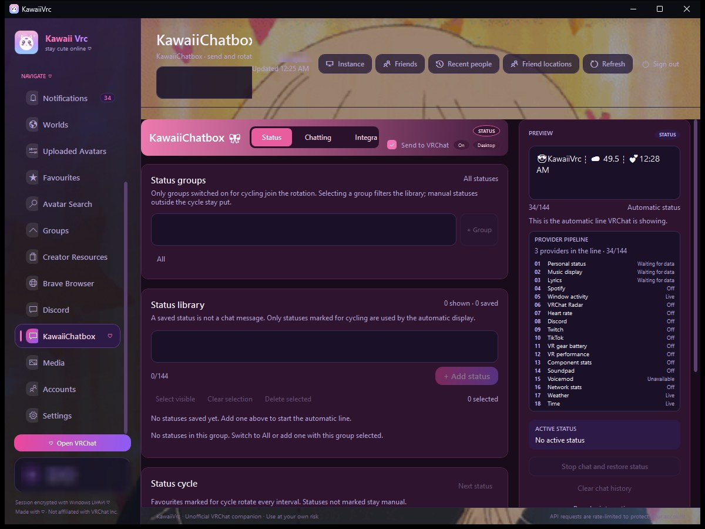
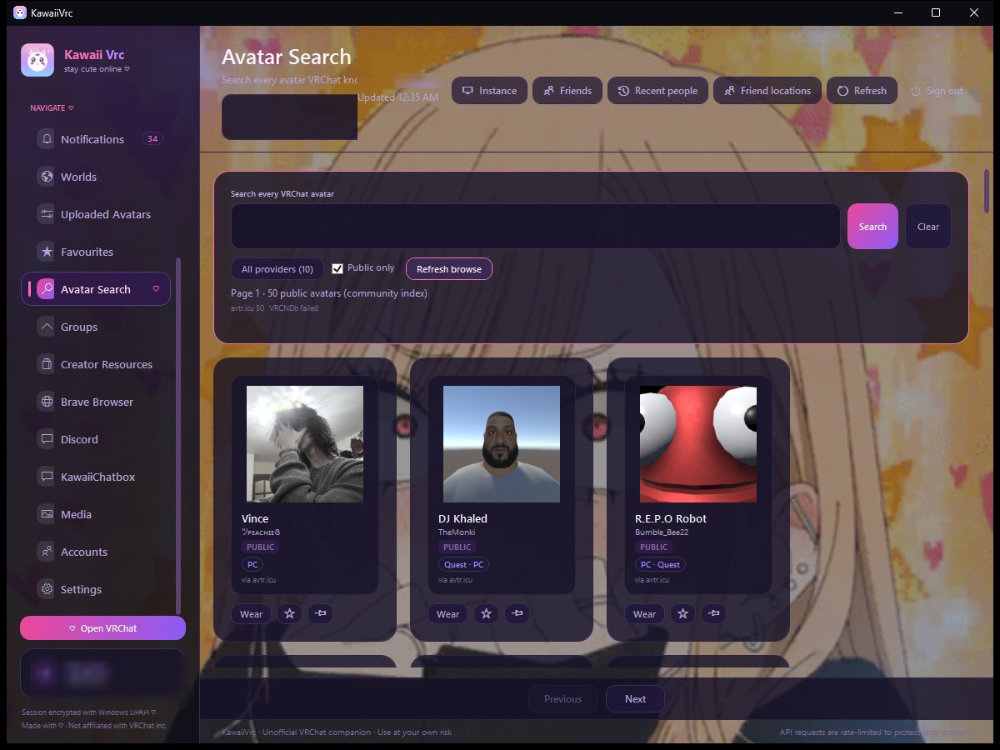
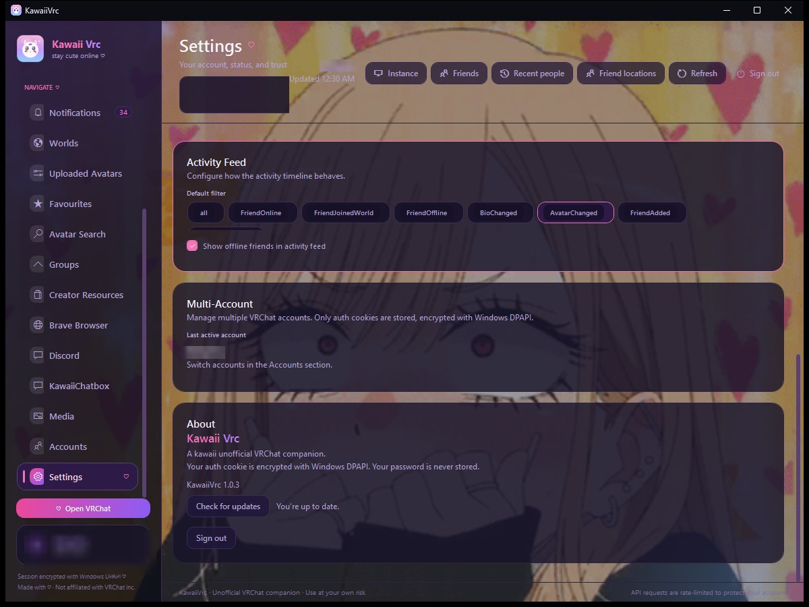

# KawaiiVrc

A kawaii unofficial Windows desktop companion for [VRChat](https://vrchat.com), built with C# and WPF on .NET 8. It keeps your VRChat account, friends, worlds, avatar library, chatbox, Discord, and a normal web browser in one window, so you can stay in a call and look things up without alt-tabbing through a pile of browser windows.

> **Not affiliated with VRChat Inc.** This app uses VRChat's unofficial web API. Use it at your own risk and respect VRChat's Terms of Service and rate limits.

## A quick look

A small, privacy-redacted preview. Account details are blurred; no friend or account names are shown.

| Worlds, search, and quick join | KawaiiChatbox |
| --- | --- |
|  |  |
| **Avatar Search** | **Settings, About, and update checks** |
|  |  |

## Current state

The current build compiles with **0 warnings and 0 errors** and has an automated suite of **473 tests** covering the API client, persistence, activity and friend changes, chatbox providers, launch flows, instance history, browser behavior, and WPF layout.

Recent work includes:

- Persistent per-account activity history and friend-change history.
- A saved friend snapshot per account, so friended and unfriended events that happen while the app is closed are verified on the next launch.
- Realtime VRChat presence and notifications over the authenticated websocket, with polling as a fallback.
- A rebuilt chatbox with separate Status, Chatting, Integrations, and Options pages.
- Multi-account support, named VRChat launch profiles, instance history, local friend notes, and saved invite messages.
- Embedded Brave and Discord tabs with low-memory behavior when hidden or minimized.

## Start here

1. Install the [.NET 8 SDK](https://dotnet.microsoft.com/download/dotnet/8.0) and make sure the Microsoft Edge WebView2 Runtime is installed. It is already present on most Windows 10 and Windows 11 PCs.
2. From the repository root, build and run:

   ```powershell
   dotnet build VrcCompanion.sln -c Release
   dotnet run --project VrcCompanion -c Release
   ```

3. Sign in with your VRChat username and password. If your account uses two-factor authentication, enter the authenticator, email, or recovery code when prompted.
4. Use the left sidebar for **Profile**, **Activity**, **Friends**, **Notifications**, **Worlds**, **Avatars**, **Favourites**, **Avatar Search**, **Groups**, **Creator Resources**, **Brave Browser**, **Discord**, **KawaiiChatbox**, **Media**, **Accounts**, and **Settings**.
5. For Discord, sign in on Discord's own page inside the tab. Once it loads, you can join a voice channel and switch tabs or minimize the app without dropping the call.
6. For general browsing, open **Brave Browser**, type a search or address, and press Enter.

The toolbar also exposes the current **Instance**, **Friends**, **Friend locations**, **Friend changes**, **Refresh**, and **Open VRChat** actions.

## Requirements

- Windows 10 or Windows 11.
- [.NET 8 SDK](https://dotnet.microsoft.com/download/dotnet/8.0) to build the project. Newer SDKs can also build it.
- .NET 8 Desktop Runtime for framework-dependent builds.
- Microsoft Edge WebView2 Runtime for the Discord and Brave tabs.
- A VRChat account with a username and password. Accounts that only sign in through Steam, Meta, or PICO without a VRChat password are not supported.
- VRChat installed and registered for `vrchat://` links if you want the join and launch actions to open the game.

## What is in the app

### Profile and social

- **Profile** — your avatar, display name, trust level, badges, bio, pronouns, groups, and account details. The profile popup supports a custom backdrop image.
- **Friends** — searchable friends list with Online, Active, Join Me, and Offline filters; local favourites; trust badges; and a detail pane with notes, join, invite, request invite, copy location, open world, and profile actions.
- **Player search** — search for a VRChat user by name and open their profile, even if they are not already on your friends list.
- **Friend changes** — a Friended/Unfriended history with all, friended, and unfriended filters. Changes are verified against VRChat before they are recorded. Events first found by comparing the previous-launch snapshot are marked **detected on next launch**, because the exact offline moment is not available from VRChat.
- **Notifications** — unread counts, type filters, mark-read actions, friend requests, invites, and accept/decline actions. Invites and invite requests survive a restart, and you can decline with a message or accept an invite request through the shared composer.
- **Accounts** — save and switch between VRChat accounts. Only auth cookies are stored, encrypted with Windows DPAPI; passwords are never written to disk.

### Worlds, instances, and history

- **Worlds** — popular public worlds, search, favourites, world details, active instance lists, instance creation, and a quick-join box that accepts `vrchat://` links, `vrch.at` links, full world/instance locations, and instance IDs.
- **Instance** — the current instance's world, players, share link, and join/open actions.
- **Friend locations** — shows which friends are currently in a joinable world, with their instance details.
- **Instance history** — build a local history from VRChat's own log: worlds visited, sessions, players seen, timestamps, search, and launch/open actions. Stored per account in SQLite under your local app data.

### Avatars, groups, and media

- **Avatars** — your VRChat avatar library, current avatar, wear/switch actions, and details.
- **Avatar Search** — search public avatars from the VRChat catalog and wear or favourite them.
- **Favourites** — VRChat favourite-avatar slots and locally saved favourite friends, worlds, avatars, and groups in their respective views.
- **Groups** — browse your VRChat groups and open group details.
- **Media** — your local `Pictures\VRChat` library, grouped by world and month, with paging, cache, and an Open folder action.
- **Creator Resources** — shortcuts to creator marketplaces and official VRChat tools.

### Activity

- **Activity** — a persistent per-account timeline of friend online/offline events, world joins, bio changes, avatar changes, and Friended/Unfriended events.
- Filter by All, Online, Joined world, Offline, Bio changed, Avatar changed, Friended, or Unfriended.
- Search by friend, world, or activity text.
- Activity and friend-change history survive a restart. The last selected filter is remembered.
- Friended/Unfriended rows show both a relative age and an absolute local date/time.

### Launching and VR

- **Desktop and VR launch modes** from the bottom of the sidebar.
- **Advanced launch profiles** — create, edit, duplicate, select, and delete named profiles containing extra VRChat command-line arguments, including raw options such as `--profile=N`. The active profile is applied whenever the app opens VRChat or handles a join.
- **Join links** are handed to the running VRChat client when possible; the app keeps a single VRChat instance rather than starting a second client.
- **OpenVR shutdown handling** acknowledges SteamVR's quit event and releases OpenVR before shutdown, so closing SteamVR does not close the companion.
- **VR providers** for battery and performance are available through OpenVR when enabled.
- **SlimeVR battery** support can be used as an optional chatbox battery source.

### KawaiiChatbox

The chatbox is split into four pages:

- **Status** — a saved status library with groups, group filtering, favourites-only cycling, weighted random order, sorting, bulk selection, and an automatic status cycle.
- **Chatting** — a separate composer with the last five chat messages, resend/edit, keep-updating, live typing, and autocomplete.
- **Integrations** — enable, disable, and reorder providers independently, with a live preview of the exact line VRChat receives.
- **Options** — OSC host/port, update timing, manual override countdown, minimal-background mode, and other chatbox behavior.

The provider pipeline supports personal status, music, lyrics, window activity, time, VR battery, VR performance, VRChatRadar, heart rate, Discord, Twitch, TikTok, VR, component stats, Soundpad, Voicemod, network stats, weather, and more where the source is available. It preserves prefix/suffix text, drops the highest-priority provider first on overflow, clips the last survivor with an ellipsis, and enforces VRChat's 144-character `/chatbox/input` limit.

Typed chat temporarily overrides the automatic line for a configurable countdown. Music supports play/pause state, source, elapsed and remaining time, and a seekbar token. Window activity supports desktop/VR headings and focus tokens. Time supports local 12/24-hour time, zone, and date tokens. Minimal-background mode uses VRChat's control-character trick to shrink the gray bubble; VRChat does not expose true transparency.

### Desktop tools

- **Brave Browser** — a general in-app browser backed by Brave Search, with cached page/search state, per-site Brave Shields, focus mode, and persistent tabs. Shields are powered by Brave's open-source `adblock-rust` engine, its official EasyList, EasyPrivacy, uBlock Origin, and Brave filter lists, and Brave's own `adblock-resources` scriptlet, redirect, and replacement bundle. The panel follows Brave's three-way modes for trackers/ads, HTTPS upgrades, fingerprinting, and cookies, and includes script blocking, forgetting site data on leave, filter-list details, and global defaults across Brave, Discord, and Creator Resources.
- **Discord** — Discord's web app with quick actions for friends, servers, and settings. Voice calls keep running while the tab is hidden or the window is minimized.
- **Settings** — appearance and backdrop options, profile-popup background, activity defaults, multi-account controls, chatbox and OSC settings, browser options, and About information. Launch modes and advanced launch profiles are on the launch bar at the bottom of the sidebar.

## Browser tabs and low-memory mode

Brave and Discord are real WebView2 tabs, not screenshots or embedded shortcuts. Each visited tab stays alive when you switch away, so its page, scroll position, search text, and Discord voice connection remain intact.

When a browser tab is hidden or the whole app is minimized, the app asks WebView2 to use its **Low** memory target. Hidden tabs keep their scripts, network connections, and Discord voice session alive; Chromium releases what it can and swaps memory back in when the tab is shown again. The selected tab returns to **Normal** when the window is restored.

On a five-minute idle test with both Discord and Brave cached, the app's total working set dropped from about **955 MB** to **614 MB** while minimized. After restoring, it settled around **642 MB** — it stays trimmed instead of immediately re-inflating. This is a resident-memory saving, not a promise that committed memory will shrink; Chromium may page data to disk and load it again later.

The important behavior is:

- Hidden tabs and a minimized window use `Low`.
- The selected tab uses `Normal`.
- Discord voice stays connected while hidden or minimized.
- No replay or reload is required when you switch back.

## Build, run, and test

Build the whole solution:

```powershell
dotnet build VrcCompanion.sln -c Release
```

Run the automated tests:

```powershell
dotnet test VrcCompanion.sln -c Release
```

The built executable is at:

```text
VrcCompanion\bin\Release\net8.0-windows10.0.19041.0\KawaiiVrc.exe
```

You can also open `VrcCompanion.sln` in Visual Studio 2022 and run the `VrcCompanion` project as **KawaiiVrc**.

## Data and security

- Login credentials go directly to `https://api.vrchat.cloud` over HTTPS.
- The remembered VRChat session is stored at `%LOCALAPPDATA%\VrcCompanion\session.dat`, encrypted with Windows DPAPI for the current Windows account.
- Multi-account cookies are stored under `%LOCALAPPDATA%\VrcCompanion\accounts\`, also protected with DPAPI. Passwords are never stored.
- Local app data can include:

  ```text
  %LOCALAPPDATA%\VrcCompanion\
    session.dat
    settings.json
    accounts\
    notifications.json
    activity.json
    friend-snapshots.json
    friend-notes.json
    invite-messages.json
    instance-history.db
    media-index.json
    imagecache\
    crash.log
    lifecycle.log
  ```

- `activity.json` and `friend-snapshots.json` are how activity and offline friend-change detection survive a restart. They contain friend identities and activity metadata, not your password.
- `instance-history.db` is built only from VRChat logs on this PC and contains worlds, sessions, and players you actually encountered.
- Discord sign-in happens on Discord's own page inside the embedded browser. The app does not read or store your Discord password.
- Crash reports are written to `%LOCALAPPDATA%\VrcCompanion\crash.log`. The small lifecycle log records startup, window closing, Windows session ending, and OpenVR shutdown.
- The app has no telemetry. It contacts VRChat, Discord, and the sites you open in the browser tabs.
- Delete the data folder to remove local state. Signing out removes the saved VRChat session but keeps settings, notes, and locally recorded history until you delete the folder. Do not use the app for automation, scraping, spam, or running multiple clients against one account.

## Troubleshooting

- **The app does not start or shows an unexpected error:** check `%LOCALAPPDATA%\VrcCompanion\crash.log`.
- **The Discord or Brave tab is blank:** install the Microsoft Edge WebView2 Runtime and restart the app.
- **Discord voice drops:** check that the app is not being force-closed and that Windows is not blocking Discord's microphone or network access.
- **"VRChat refused the request (403)":** verify your email and complete any account checks on the VRChat website.
- **"VRChat's rate limit was reached":** wait a minute or two, then refresh.
- **A saved session stops working:** the auth cookie expired or was revoked. Sign out and sign in again.
- **2FA codes are rejected:** make sure the code is current; authenticator codes rotate every 30 seconds.
- **World images do not load:** the image host may be blocked by your network or firewall.
- **Join or Launch VRChat does nothing:** install VRChat and make sure it is registered for `vrchat://` links. Launching it once from the official website or Steam usually registers the handler.
- **No active instances are listed:** VRChat only exposes public and friends-visible instances to this API; create one from the world popup instead.
- **A friend change says "detected on next launch":** the app found it by comparing the last saved friend list. VRChat does not expose the exact offline friendship-change time, so the displayed timestamp is when the next launch verified it.

## Project layout

```text
VrcCompanion/
  App.xaml                   Theme, styles, and converters
  MainWindow.xaml            Shell, sections, login, and popups
  Controls/
    EmbeddedBrowser.xaml.cs  WebView2 host and low-memory behavior
    CosmeticImage.cs         Animated profile decorations
  Models/                    VRChat JSON and local persistence models
  Services/                  API, session storage, images, launches, OSC, chatbox, history
  ViewModels/                MVVM state and commands
  Converters/                UI converters
  Themes/                    Section and media templates
VrcCompanion.Tests/          Automated unit, layout, and integration tests
docs/screenshots/            Redacted README previews
```

## Known limitations

- Friend presence and notifications use VRChat's authenticated realtime websocket, with the polling refresh kept as a fallback. If the websocket is unavailable, presence can still fall back to the normal refresh interval.
- Friended/Unfriended events found only after a relaunch show the verification time, not the exact moment the friendship changed. VRChat has no API for that timestamp.
- World search returns a limited set of public results.
- Active instance lists only include what VRChat exposes to the API and exclude private instances you cannot see.
- Some chatbox providers depend on another local app or service being available; unavailable providers report that state instead of inventing data.
- The UI is English-only.
- The app is intended for personal, interactive desktop use, not unattended automation.
- The low-memory mode is best-effort. Chromium may keep or release different amounts of memory depending on the pages and call state.
